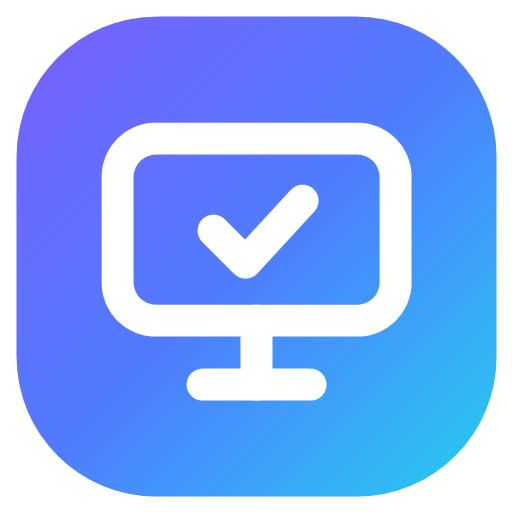
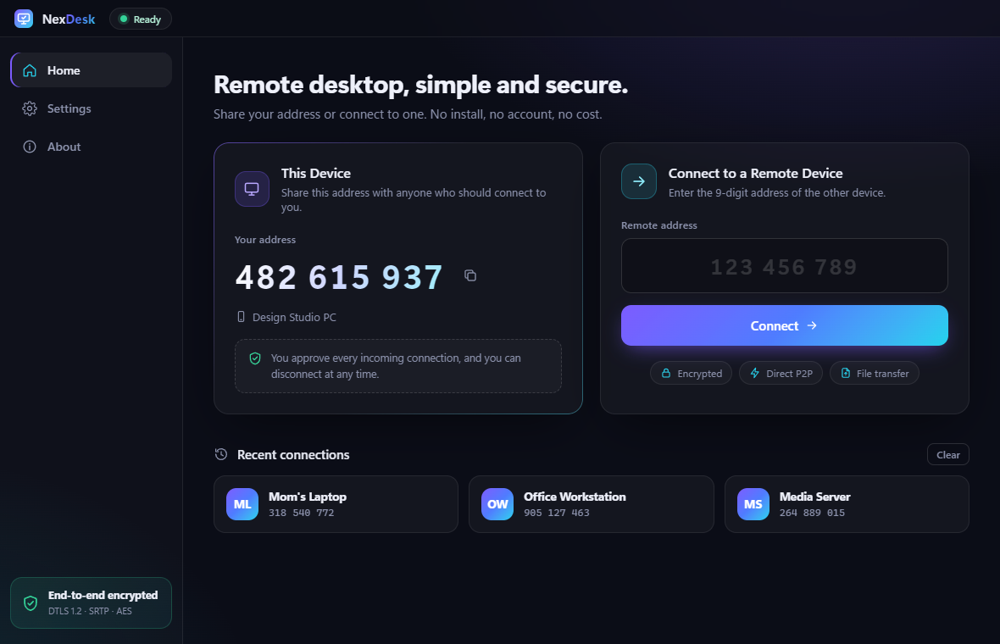
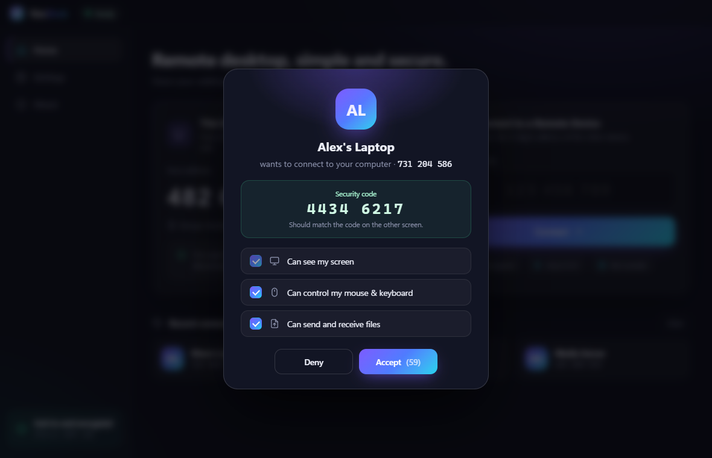
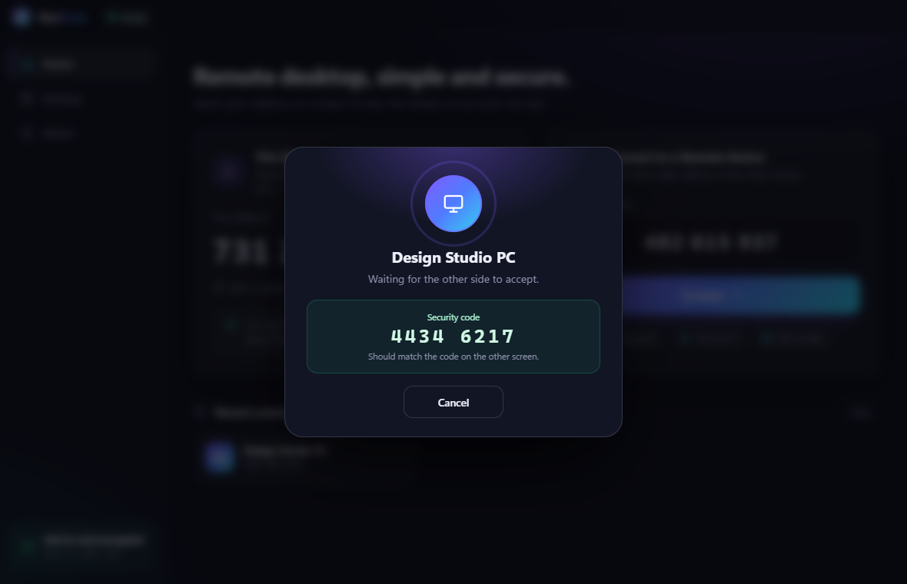
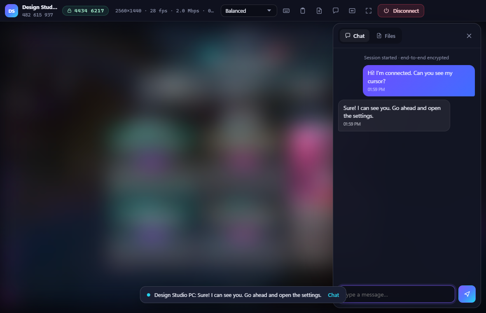
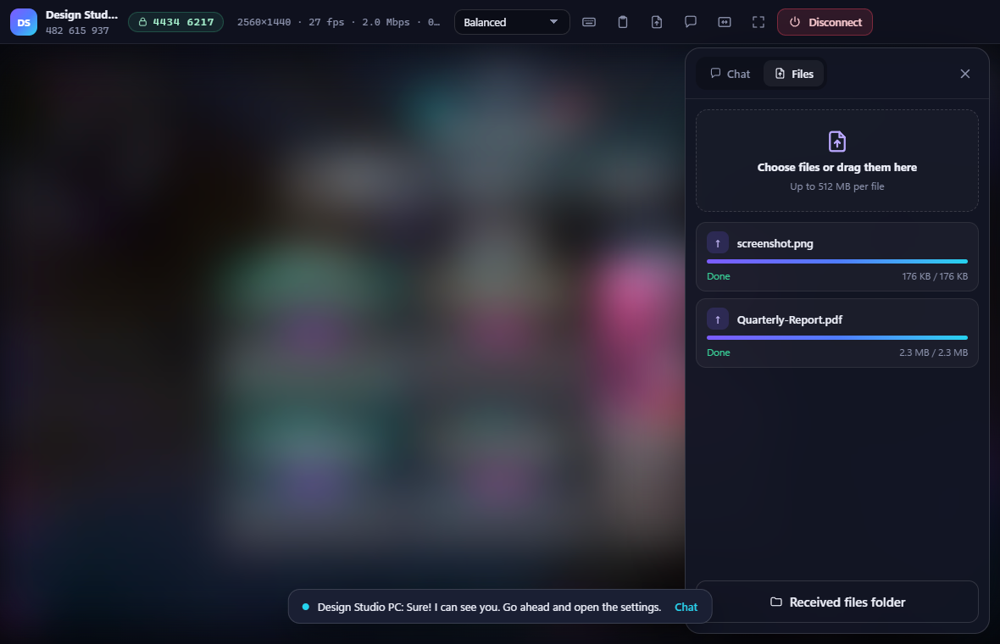
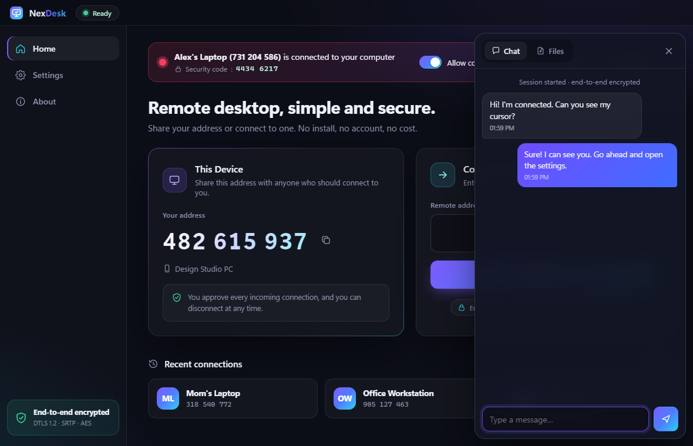
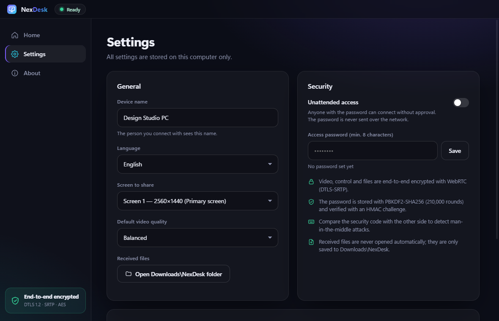

<div align="center">



# NexDesk

**Free, open-source and portable remote desktop & remote support.**
A lightweight alternative to AnyDesk and TeamViewer: no installation, no account, no subscription.


[**Download**](../../releases/latest) · [Features](#-features) · [How it works](#-how-it-works) · [Security](#-security) · [Build from source](#-build-from-source)



</div>

---

## ✨ Features

| | |
|---|---|
| 🖥️ **Remote control** | See the remote screen in real time and control its mouse and keyboard. |
| 🔐 **End-to-end encrypted** | Video, input, chat and files travel directly between the two PCs over DTLS-SRTP. |
| ✅ **Approval required** | Every incoming connection must be accepted on the remote PC, with per-session permissions. |
| 🔢 **Security code** | Both sides see an 8-digit code derived from the encryption keys, so a man-in-the-middle can be spotted. |
| 📁 **File transfer** | Send files both ways with drag & drop (up to 512 MB per file). |
| 💬 **Chat & clipboard** | Built-in chat, plus one-click clipboard text sharing. |
| 🔑 **Unattended access** | Optional password-based access to your own machines, without the password ever touching the network. |
| ⌨️ **Special keys** | Win key, Alt+Tab, Task Manager, Win+R, Win+L and more from the toolbar. |
| ⚡ **Adaptive quality** | High (up to 60 fps), Balanced, or Fast for slow connections, with live fps, bitrate and latency stats. |
| 🧳 **Portable** | A single `.exe`. Download, double-click, done. |
| 🌍 **Multi-language** | English and Turkish. |

## 📸 Screenshots

<table>
  <tr>
    <td width="50%"><p align="center"><sub>Incoming request with permissions and security code</sub></p></td>
    <td width="50%"><p align="center"><sub>Waiting for approval: compare the security code</sub></p></td>
  </tr>
  <tr>
    <td width="50%"><p align="center"><sub>Remote session with chat (remote screen blurred for privacy)</sub></p></td>
    <td width="50%"><p align="center"><sub>Two-way file transfer</sub></p></td>
  </tr>
  <tr>
    <td width="50%"><p align="center"><sub>Host side: always know who is connected, revoke control anytime</sub></p></td>
    <td width="50%"><p align="center"><sub>Settings: unattended access, screen, quality, TURN</sub></p></td>
  </tr>
</table>

## 🚀 Getting started

1. Download **`NexDesk-x.y.z-portable.exe`** from the [latest release](../../releases/latest).
2. Run it on **both** computers. No installation needed.
3. The person who needs help reads out their **9-digit address**.
4. The helper types the address and clicks **Connect**.
5. The person who needs help checks that the **security code** matches and clicks **Accept**.

That's it. To end the session, either side clicks **Disconnect**.

> **Windows SmartScreen:** because the executable isn't code-signed yet, Windows may show
> *"Windows protected your PC"*. Click **More info → Run anyway**. You can verify the file
> against the SHA-256 checksum published with every release, or build it yourself.

## 🧠 How it works

```
 ┌────────────────┐   1. "who is 482 615 937?"   ┌──────────────────────┐
 │  Helper (you)  │ ───────────────────────────▶ │  Signaling server    │
 │  NexDesk       │ ◀─────────────────────────── │  (PeerJS, public)    │
 └───────┬────────┘   2. exchange SDP / ICE      └──────────┬───────────┘
         │                                                   │
         │        3. direct, encrypted P2P connection        │
         │  ◀═══════════════════════════════════════════▶   ▼
         │      screen (SRTP) · input/chat/files (DTLS)   ┌────────────────┐
         └───────────────────────────────────────────────▶│  Remote PC     │
                                                          │  NexDesk       │
                                                          └────────────────┘
```

- **Electron** app; screen capture uses Chromium's native desktop capturer.
- **WebRTC** carries the screen as a video stream and everything else over a reliable data channel.
- **PeerJS** public cloud server is used *only* to find the other peer and exchange connection
  offers. It never sees your screen, keystrokes or files.
- **NAT traversal** uses public STUN servers. On very restrictive networks (symmetric NAT,
  corporate firewalls), add your own TURN server under *Settings → Network*.
- **Input injection** on Windows goes through `user32` (`SendInput`-family APIs) via a tiny helper
  that only accepts numeric commands, so no native Node modules are needed.

## 🔒 Security

NexDesk is built so that nothing happens on your computer without your consent.

| Layer | What we do |
|---|---|
| **Transport** | All media and data are end-to-end encrypted by WebRTC (DTLS 1.2+ / SRTP, AES). The signaling server only relays connection setup. |
| **Consent** | Every connection requires an explicit **Accept** on the host, with toggles for *control* and *files*. Requests time out after 60 seconds. |
| **MITM detection** | An 8-digit **security code** = `SHA-256(sorted DTLS fingerprints)` is shown on both sides. If they match, nobody is in the middle. |
| **Unattended access** | The password is stored only as a PBKDF2-SHA256 verifier (210,000 iterations, random salt). Login is an HMAC **challenge/response** bound to the session's DTLS fingerprints: the password never leaves the client, and a relayed proof is useless. |
| **Brute force** | 5 wrong passwords lock unattended access for 5 minutes. |
| **Live control** | The host sees a red banner for the whole session, can revoke control instantly, and can disconnect at any time. Held keys and buttons are released automatically. |
| **Files** | Received files are streamed into `Downloads\NexDesk`, file names are sanitized (no path traversal, no reserved names), sizes are enforced, and files are **never opened automatically**. |
| **App hardening** | `contextIsolation`, `sandbox`, no `nodeIntegration`, strict Content-Security-Policy, navigation and pop-ups blocked, minimal permission set. |

Found a vulnerability? Please see [SECURITY.md](SECURITY.md).

> ⚠️ **Never** accept a connection from someone you don't know. Real support teams don't cold-call you
> asking for remote access. NexDesk is a tool for helping friends, family and your own devices.

## 🛠️ Build from source

Requirements: **Node.js 18+** and Windows (for the portable build).

```bash
git clone https://github.com/A03055/NexDesk.git
cd NexDesk
npm install
npm start          # run in development
npm run dist       # build dist/NexDesk-<version>-portable.exe
```

Test two instances on one machine:

```bash
npm run dev:a      # profile "a"
npm run dev:b      # profile "b"  (connect to a's address)
```

### Project layout

```
src/
├── main.js          # Electron main: window, capture, input injection, auth, file I/O
├── preload.js       # Minimal, typed bridge exposed to the UI
└── renderer/
    ├── index.html   # UI
    ├── style.css    # Design
    ├── app.js       # Signaling, sessions, input capture, chat, file transfer
    ├── keymap.js    # Layout-independent scan-code map
    └── i18n.js      # Translations (EN / TR)
```

### Releasing

Push a tag like `v1.0.0` and the included GitHub Actions workflow builds the portable `.exe`
and attaches it, together with its SHA-256 checksum, to a GitHub Release.

## 🗺️ Roadmap

- [ ] Multi-monitor switching during a session
- [ ] Audio streaming
- [ ] Self-hostable signaling server option
- [ ] macOS / Linux host support
- [ ] Session recording

Contributions are welcome. Open an issue or a pull request!

## ⚖️ License

[MIT](LICENSE). Free for personal and commercial use.

NexDesk is an independent project and is not affiliated with AnyDesk Software GmbH or TeamViewer SE.
